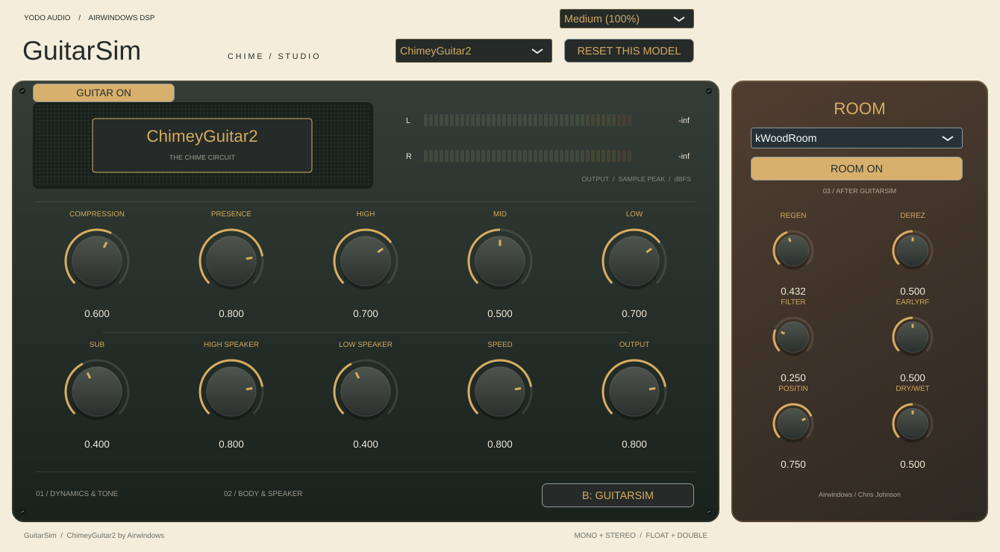

# GuitarSim

A JUCE VST3 interface for **ChimeyGuitar2**, **ChimeyGuitar**, and **ChimeyDeluxe** by [Airwindows](https://github.com/airwindows/airwindows). Built in the visual family of [ToTape Studio](https://github.com/johandoornenbal/tape) and [Wide](https://github.com/johandoornenbal/wide): cream faceplate, dark green chassis, gold rotary controls, and a speaker-cloth model badge.

**GuitarSim** is the name shown in your DAW. ChimeyGuitar2 is selected by default. Every algorithm keeps its own ten controls and original Airwindows defaults when you switch models and save your DAW session. There is no LUFS compensation, automatic gain adjustment, or level-learning system.



The separate **Room** section on the right adds Airwindows room processing
**after the selected guitar algorithm**. Choose **kWoodRoom** (the default) or
**WoodenBox**, with independent saved parameter banks. WoodenBox exposes its original
Select, Reso and Depth controls, each defaulting to 0.5. Use **ROOM ON/BYPASSED** to engage or bypass
it with a 10 ms crossfade. It defaults to off, including when opening older
sessions. kWoodRoom’s six original normalized controls (Regen, Derez, Filter, EarlyRF,
Positin, Dry/Wet) and defaults are preserved; double-click resets each control.
The **GUITAR ON/BYPASSED** button independently bypasses the first stage,
allowing room-only processing. Bypassed stages have dimmed, disabled controls and
selectors; their engage buttons remain available. Both stages retain their settings.
Room settings are shared across guitar models and saved with the session.
The model reset button leaves room settings unchanged. A/B compares the original
input with the complete guitar-plus-room chain, and meters show the final output.

[WoodenBox preview](docs/ui-WoodenBox.png) · [Both stages bypassed](docs/ui-bypassed.png)

## Controls

- **Algorithm:** choose ChimeyGuitar, ChimeyGuitar2, or ChimeyDeluxe. Switching resets the entering engine's audio history to avoid carrying old filter/compressor state into a new audition.
- **Rotary controls:** drag or type a value from 0 to 1; double-click to restore that control's original default. Each model exposes its actual Airwindows parameters.
- **Reset this model:** restores only the selected algorithm's controls. Other algorithms retain their settings.
- **A: Original input / B: GuitarSim:** compare dry and processed audio with a 10 ms crossfade. This does not match their loudness. The engines continue running while listening to Original.
- **Output meters:** stereo sample peaks, with red segments at and above 0 dBFS. The display decays when playback stops. No limiter is applied.
- **Interface size:** 75%, 100%, or 125%, saved with the session.

ChimeyGuitar and ChimeyGuitar2 expose Compression, Presence, High, Mid, Low, Sub, High Speaker, Low Speaker, Speed, and Output. ChimeyDeluxe exposes Hell, Fizz, Pick, Satan, Danger, Critical, High Meat, Low Meat, Swing, and Rarely. Values use the upstream normalized scale; the UI does not invent dB or frequency units for these nonlinear controls.

Mono and stereo channel layouts and float/double processing are supported. Mono input is fed to both engine channels; the left output is returned. No fixed latency is added or reported. Internal filter/compressor phase and dynamics are part of each model's sound.

## Download and install

Open [Actions → Build GuitarSim](https://github.com/johandoornenbal/guitarsim/actions/workflows/build.yml), select a successful run, and download **GuitarSim-macOS-arm64**. Extract the artifact and its inner ZIP, then copy the entire **GuitarSim.vst3** bundle to `~/Library/Audio/Plug-Ins/VST3`. The build targets Apple Silicon, including M2 and later Macs.

Rescan plugins in your DAW. The macOS build targets Apple Silicon (macOS 11+) and is ad-hoc signed, with a ZIP that preserves bundle permissions; it is not notarized. GitHub requires you to be signed in to download workflow artifacts.

## Build, sign, and install on your Mac

Install Xcode Command Line Tools (`xcode-select --install`) and CMake 3.22+ (`brew install cmake`), close your DAW, then run from the repository:

```sh
bash scripts/build-sign-install-mac.sh
```

This builds and tests the Apple Silicon VST3, ad-hoc signs a staged copy, verifies its signature, and installs it to `~/Library/Audio/Plug-Ins/VST3/GuitarSim.vst3`. An existing installation is replaced only after the new bundle passes signing and verification. Restart or rescan plugins in your DAW.

To sign and install an already downloaded/extracted bundle without compiling:

```sh
bash scripts/build-sign-install-mac.sh --install-only "/path/to/GuitarSim.vst3"
```

The script targets arm64 for M2 and later, uses no `sudo`, and follows the `codesign`/`ditto` installation approach from Tape and Wide. Run it in a native Apple Silicon terminal. Optional `GUITARSIM_BUILD_DIR` and `GUITARSIM_INSTALL_DIR` environment variables override the build and installation folders. Additional CMake configure arguments can be passed to the script, for example `-DJUCE_PATH=/absolute/path/to/JUCE`.

This is a **VST3** plugin; Logic Pro requires an Audio Unit and cannot load it.

## Build

Requires CMake 3.22+, a C++17 compiler, and Git. CMake fetches JUCE 8.0.12 at a pinned commit, or accepts `-DJUCE_PATH=/path/to/JUCE`.

```sh
cmake -S . -B build -DCMAKE_BUILD_TYPE=Release -DBUILD_TESTING=ON -DCMAKE_OSX_ARCHITECTURES=arm64 -DCMAKE_OSX_DEPLOYMENT_TARGET=11.0
cmake --build build --config Release --parallel 2
ctest --test-dir build -C Release --output-on-failure
```

For development checks on Linux, omit the macOS configure flags. Linux dependencies:

```sh
sudo apt-get install libasound2-dev libx11-dev libxext-dev libxinerama-dev libxrandr-dev libxcursor-dev libfreetype6-dev libfontconfig1-dev libgl1-mesa-dev xvfb
xvfb-run -a ctest --test-dir build --output-on-failure
```

The plugin is written to `build/GuitarSim_artefacts/Release/VST3/GuitarSim.vst3`. CI builds and tests on macOS Apple Silicon, and renders the actual JUCE editor for all three algorithms into the `GuitarSim-UI-previews` artifact.

For the DSP tests without JUCE or GUI dependencies:

```sh
cmake -S . -B build-dsp -DGUITARSIM_DSP_ONLY=ON
cmake --build build-dsp
ctest --test-dir build-dsp --output-on-failure
```

The DSP tests compare the ports against the unmodified upstream implementations at multiple rates and parameter endpoints, including smaller blocks, and check float silence. Plugin checks cover model routing, saved banks, dry comparison, mono processing, editor attachment rebinding, per-model reset, size selection, and rendering.

## Source and licensing

Airwindows DSP is MIT licensed. Unmodified reference sources and their license are under `third_party/airwindows`; the SDK-free DSP ports are under `Source`. Run `python3 scripts/port-engines.py` to reproduce the ports. DSP processing is unchanged; ports use deterministic dither seeds, omit the VST2 interface, and add bounds/finite checks to the parameter setter. Scratch audio buffers are allocated in `prepareToPlay`, not on the audio thread. Host blocks up to the greater of the announced maximum and 8192 samples preserve upstream block boundaries; oversized blocks are processed in bounded chunks.

GuitarSim is an independent interface, not an official Airwindows release. See [THIRD_PARTY.md](THIRD_PARTY.md) for provenance and JUCE licensing.
